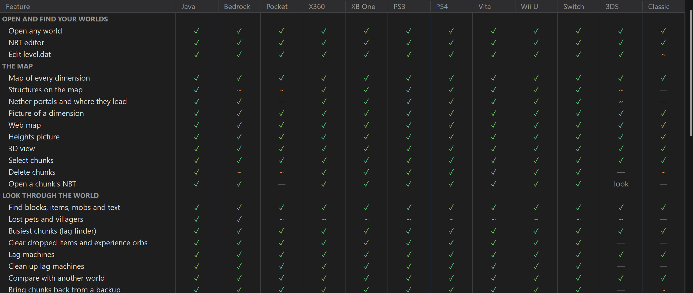
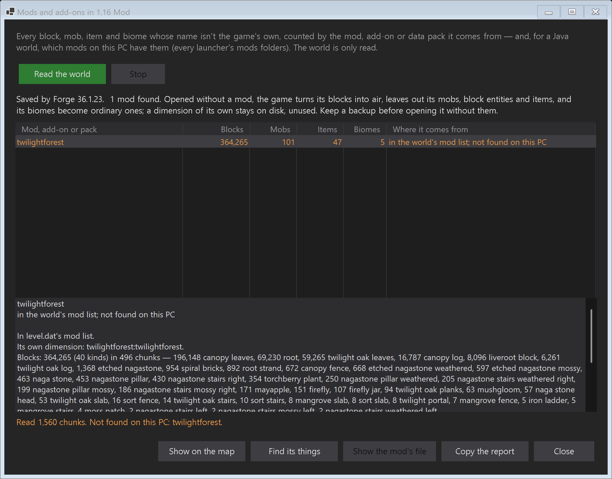
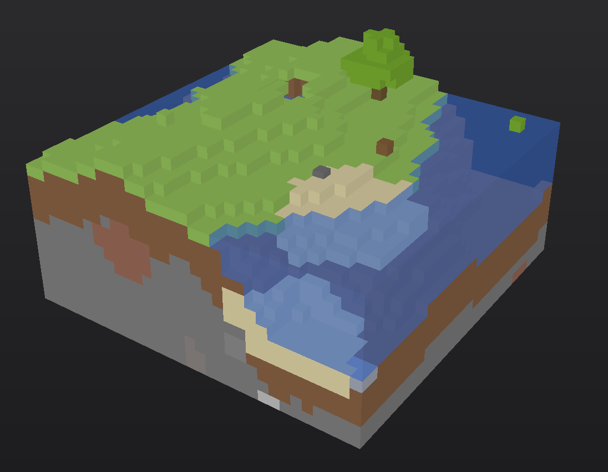

# IcyModz420's Minecraft Studio

A Windows tool for opening, inspecting, repairing, editing and converting Minecraft worlds from every edition:
Java Edition (Classic through 26.x), Bedrock (including Pocket Edition), the Legacy Console editions
(Xbox 360, Xbox One, PS3, PS4, PS Vita, Wii U, Switch) and the New Nintendo 3DS Edition. It also includes
studios for skins, textures, mobs and animations.



## Download

Download the latest build from the [Releases](../../releases) page, unzip it anywhere and run
`MinecraftStudio.exe`. It runs on 64-bit Windows 10 and 11; nothing else needs to be installed.

## Features

**Worlds**
- Opens any world folder or save file and works out which edition and version it is.
- Lists the Java and Bedrock worlds on the PC, and copies worlds off an Android phone over USB or Wi-Fi.
- NBT editor for level.dat, player files, chunks and structures; Bedrock database browser; region file viewer.

**Map**
- Every dimension, with a cave view, biome and slime chunk overlays, saved structures (with loot that hasn't been
  taken yet), Nether portals and where they lead, and where players last died.
- Exports a picture, a heightmap, or a web map that opens in any browser.
- 3D view of any area or structure.

**Inspect**
- Find blocks, items (including items inside shulker boxes), mobs and text, with results marked on the map.
- Lost pets with their owners, villager trades, the busiest chunks, and lag machines.
- Lists every mod, add-on and data pack a world depends on, and which of them are installed on the PC.
- Compares two worlds block by block, even across editions, and brings chunks back from a backup.

**Edit** (changes go into a copy of the world, and every block is checked)
- Save and place buildings as Java `.nbt`, WorldEdit `.schem`, Litematica `.litematic`, Bedrock `.mcstructure`
  or MCEdit `.schematic`, turned or mirrored, with a material list and a build checker.
- Replace blocks, change biomes, and flatten, smooth, raise or lower terrain.
- Map art from any picture, given to a player as maps or saved as schematics to build.

**Players**
- Inventories, armour, ender chests, statistics and advancements.
- Move a stuck player to safety, restore a Hardcore world after death, and copy items between worlds and editions.
- Game mode, game rules, spawn point, time, weather and world border.

**Convert and keep safe**
- Converts any edition and version to any other (Java 26.1 back to Infdev, Bedrock, Pocket Edition, all seven
  consoles, Classic and Indev), then checks the result against the original.
- Rescues damaged worlds, makes backups (automatically if you want), and packs a world into a single file.

**Create**
- Skin Studio, Texture Studio (with Java block and item models), Mob Studio and Animation Studio.
- New data pack and add-on templates for any version, and a pack checker.

[FEATURES.md](FEATURES.md) lists every feature and the platforms it works on. In the app, the same table is under
Help → What Works Where.

| Mods and add-ons in a world | 3D view |
| --- | --- |
|  |  |

## Your worlds

Tools that change a world either save into it only when you press Save, after making a backup, or write a new
copy and check it. Converting, rescuing, placing, replacing, reshaping and restoring always write a new copy.

## Command line

`mcstudio.exe` runs the same features from scripts: `info`, `targets`, `convert`, `find`, `structures`, `lag`,
`mods`, `restore`, `replace`, `biome`, `shape`, `heights`, `heightmap`, `move`, `maps`, `share`, `crop`,
`structure`, `materials`, `obj`, `packcheck` and `newpack`.

```
mcstudio info "C:\path\to\world"
mcstudio targets
mcstudio convert "C:\path\to\world" --to <target> --out "C:\path\to\new folder"
mcstudio help convert
```

It only reads the worlds and files it is given and writes its results to new folders and files.

## Building from source

You need Windows and the [.NET 8 SDK](https://dotnet.microsoft.com/download/dotnet/8.0).

```
dotnet build MinecraftStudio.sln -c Release
```

| Project | What it is |
| --- | --- |
| `MinecraftStudio.Core` | Save formats, conversion and every world tool; no UI |
| `MinecraftStudio` | The Windows app |
| `MinecraftStudio.Cli` | The `mcstudio` command line |
| `McTests` | Test harness; runs against sample worlds that are not included in the repository |

## Notes

No Minecraft textures, skins or models are included. The studios read them from the Minecraft installations on
your PC. Third-party data used by the converter is listed in [THIRD-PARTY-NOTICES.md](THIRD-PARTY-NOTICES.md).

Not an official Minecraft product. Not approved by or associated with Mojang or Microsoft.

If you find the tool useful, a subscription to IcyModz420 on YouTube is appreciated.

Copyright © 2026 IcyModz420. All rights reserved.
